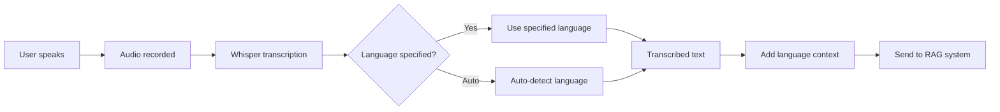

# 🌍 Multilingual Voice Support Guide

## Overview
Walmart Whisper now supports voice transcription and AI responses in **22+ languages** using OpenAI's Whisper model with automatic language detection capabilities.

## 🎤 Supported Languages

### **Voice Transcription (Whisper)**
The system supports the following languages for speech-to-text:

| Language | Code | Flag | Whisper Support |
|----------|------|------|----------------|
| **Auto-detect** | `auto` | 🌐 | ✅ Automatic |
| English | `en-US` | 🇺🇸 | ✅ Excellent |
| Hindi | `hi-IN` | 🇮🇳 | ✅ Excellent |
| Spanish | `es-ES` | 🇪🇸 | ✅ Excellent |
| French | `fr-FR` | 🇫🇷 | ✅ Excellent |
| German | `de-DE` | 🇩🇪 | ✅ Excellent |
| Italian | `it-IT` | 🇮🇹 | ✅ Excellent |
| Portuguese | `pt-BR` | 🇧🇷 | ✅ Excellent |
| Chinese | `zh-CN` | 🇨🇳 | ✅ Excellent |
| Japanese | `ja-JP` | 🇯🇵 | ✅ Excellent |
| Korean | `ko-KR` | 🇰🇷 | ✅ Excellent |
| Arabic | `ar-SA` | 🇸🇦 | ✅ Good |
| Dutch | `nl-NL` | 🇳🇱 | ✅ Good |
| Polish | `pl-PL` | 🇵🇱 | ✅ Good |
| Turkish | `tr-TR` | 🇹🇷 | ✅ Good |
| Russian | `ru-RU` | 🇷🇺 | ✅ Good |
| Thai | `th-TH` | 🇹🇭 | ✅ Good |
| Swedish | `sv-SE` | 🇸🇪 | ✅ Good |
| Danish | `da-DK` | 🇩🇰 | ✅ Good |
| Norwegian | `no-NO` | 🇳🇴 | ✅ Good |
| Finnish | `fi-FI` | 🇫🇮 | ✅ Good |

## 🔧 How It Works

### **1. Language Selection**
- Users can select their preferred language from the language selector
- **Auto-detect** option automatically identifies the spoken language
- Language context is passed to both transcription and AI response systems

### **2. Voice Transcription Process**


### **3. Backend Implementation**

#### **Whisper Transcription**
```python
def transcribe_audio_file(audio_file_path, model_name="base", language=None):
    model = whisper.load_model(model_name)
    
    if language:
        result = model.transcribe(audio_file_path, language=language)
    else:
        result = model.transcribe(audio_file_path)  # Auto-detect
        
    return result['text']
```

#### **Language Context Addition**
```python
# Add language context for better RAG processing
if language and language != "en" and language != "auto":
    language_map = {
        "es": "Spanish", "fr": "French", "de": "German", 
        "hi": "Hindi", "zh": "Chinese", "ja": "Japanese"
        # ... more languages
    }
    language_name = language_map.get(language.split('-')[0], language)
    formatted_transcript = f"[Language: {language_name}] {transcript}"
```

## 🎯 Usage Examples

### **Frontend Usage**
```typescript
// Voice button automatically uses selected language
<VoiceButton
  onTranscription={handleVoiceTranscription}
  selectedLanguage="hi-IN"  // Hindi
  userId={userId}
/>
```

### **API Usage**
```bash
# Upload audio file with language specification
curl -X POST "http://localhost:8000/api/voice" \
  -F "file=@audio.wav" \
  -F "user_id=user123" \
  -F "language=es-ES"
```

### **Response Example**
```json
{
  "transcript": "Hola, ¿cómo puedo devolver un producto?",
  "answer": "[Language: Spanish] Para devolver un producto de Walmart...",
  "sources": [...],
  "category": "return_rag",
  "chat_history": [...]
}
```

## 🚀 Features

### **✅ What Works**
- **Auto language detection** for voice input
- **22+ language support** via Whisper
- **Language context preservation** in AI responses
- **Seamless switching** between languages
- **Voice upload** with language specification
- **Live recording** with language detection

### **🔄 Language Processing Flow**
1. **User selects language** (or auto-detect)
2. **Voice recorded** in browser
3. **Audio sent to backend** with language parameter
4. **Whisper transcribes** using specified/detected language
5. **Language context added** to transcript
6. **RAG system processes** with language awareness
7. **AI response generated** with language context
8. **Response formatted** for display

## 🛠️ Technical Details

### **Model Configuration**
- **Whisper Model**: `base` (39 parameters, good balance of speed/accuracy)
- **Sampling Rate**: 16kHz (optimal for Whisper)
- **Audio Format**: WAV (supported: WAV, MP3, M4A, OGG, FLAC)

### **Language Code Mapping**
- Frontend uses **locale codes** (e.g., `en-US`, `hi-IN`)
- Backend converts to **Whisper codes** (e.g., `en`, `hi`)
- Invalid codes **fall back to auto-detection**

### **Error Handling**
```python
try:
    # Transcription with language
    transcript = transcribe_audio_file(tmp_path, "base", whisper_language)
except Exception as e:
    # Fallback to auto-detection
    transcript = transcribe_audio_file(tmp_path, "base", None)
```

## 📱 User Experience

### **Language Selector**
- 🌐 **Auto-detect** option for multilingual users
- 🎯 **21 specific languages** with native flags
- 🔄 **Real-time switching** without page reload
- 💾 **Language preference** maintained during session

### **Voice Recording**
- 🎤 **One-click recording** in any language
- 📤 **Drag & drop upload** for audio files
- ⚡ **Instant transcription** with language context
- 🔊 **Audio playback** of AI responses

## 🧪 Testing Recommendations

### **Test Cases**
1. **English**: "How do I return an item to Walmart?"
2. **Spanish**: "¿Cómo puedo devolver un artículo?"
3. **Hindi**: "मैं वॉलमार्ट में सामान कैसे वापस करूं?"
4. **French**: "Comment puis-je retourner un article?"
5. **Auto-detect**: Mix multiple languages in one session

### **Expected Results**
- ✅ Accurate transcription in selected language
- ✅ AI responses with language context
- ✅ Proper formatting and display
- ✅ Error handling for unsupported languages

## 🔍 Troubleshooting

### **Common Issues**
1. **Poor transcription quality**
   - Solution: Use quieter environment, speak clearly
   - Fallback: Try auto-detect mode

2. **Unsupported language**
   - Solution: System falls back to auto-detection
   - Check: Language code in supported list

3. **Language context not applied**
   - Solution: Verify language parameter is passed correctly
   - Check: Backend logs for language processing

### **Debug Commands**
```bash
# Test voice endpoint
curl -X POST "http://localhost:8000/api/voice" \
  -F "file=@test_audio.wav" \
  -F "user_id=debug" \
  -F "language=auto"

# Check supported languages
grep -r "supported_languages" backend/
```

## 🎉 Benefits

### **For Users**
- 🌍 **Global accessibility** - speak in your native language
- 🎯 **Better accuracy** - language-specific transcription
- 🚀 **Faster interaction** - no need to switch keyboard layouts
- 💬 **Natural conversation** - AI understands language context

### **For Business**
- 📈 **Wider user base** - serve international customers
- 🎯 **Better customer service** - language-appropriate responses
- 📊 **Usage analytics** - track popular languages
- 🔧 **Easy maintenance** - centralized language management

---

**✨ The voice module now fully supports multilingual interaction with automatic language detection and context-aware AI responses!**
